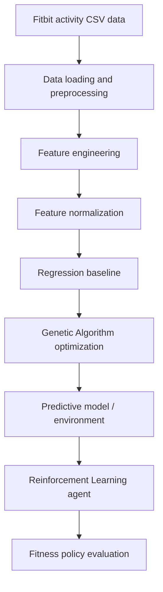

# FITGENIX — Personalized Fitness Optimization Using Reinforcement Learning and Genetic Algorithm

FITGENIX is an academic project exploring how activity data, feature engineering, predictive modelling, Genetic Algorithm (GA) optimization, and Reinforcement Learning (RL) can be combined to support personalized fitness planning.

> **Repository note:** This is a public project showcase. Selected code examples are included, while implementation-critical sections are intentionally incomplete. The notebook is not a runnable reproduction of the complete system. The full implementation is kept private by the project author.

## Project overview

The project investigates a workflow that:

1. Reads daily and hourly activity information from Fitbit-format CSV datasets.
2. Preprocesses timestamps and organizes activity records.
3. Derives activity-related features, including active minutes, step-to-calorie ratio, and an intensity score.
4. Normalizes selected numerical features for modelling.
5. Establishes regression baselines for normalized calorie prediction.
6. Explores a Genetic Algorithm to optimize the parameters of a linear predictive model.
7. Describes a model-based Reinforcement Learning environment in which an agent learns a fitness-related policy using states, actions, and rewards.

## System workflow



## Dataset files referenced

The notebook refers to these CSV files:

- `dailyActivity_merged.csv`
- `hourlyCalories_merged.csv`
- `hourlySteps_merged.csv`

The dataset itself is **not included** in this repository. Obtain it from its original authorized source, review its terms, and place the files in your own local data directory if you are reproducing the workflow. Do not commit private, identifiable, or unlicensed data.

## Feature engineering

| Feature | Purpose described in the project notebook |
|---|---|
| `ActiveMinutes` / `TotalActiveMinutes` | Represents the user's active time |
| `StepCalorieRatio` | Represents the relationship between steps and calories |
| `IntensityScore` | Represents activity intensity as a derived score |
| Normalized activity features | Places selected numerical inputs on a comparable 0–1 scale |

## Methods explored

- **Regression baselines:** Linear Regression and Ridge Regression are referenced for normalized calorie prediction.
- **Genetic Algorithm:** The notebook outlines a population-based optimization approach, including fitness evaluation, parent selection, crossover, and mutation.
- **Reinforcement Learning:** The notebook describes a fitness environment and a Q-learning agent, with state, action, reward, and policy concepts.

The public notebook intentionally omits key implementation details. Method descriptions in this repository should be read as a project overview, not as a complete implementation or a claim of independently reproducible results.

## Technology stack

- Python
- Jupyter Notebook
- Pandas and NumPy
- Scikit-learn
- Matplotlib and Seaborn
- Genetic Algorithm concepts
- Reinforcement Learning / Q-learning concepts

## Repository contents

```text
FYP-RL-GA-Personalized-Fitness-Optimization/
├── README.md
├── FYP_RL_GA.ipynb
├── fyp_rl_ga.py
├── METHODOLOGY.md
├── .gitkeep   (results)
```

## Setup

Create and activate a Python virtual environment, then install the listed dependencies:

```bash
python -m venv .venv
```

Windows PowerShell:

```powershell
.venv\Scripts\Activate.ps1
```

macOS / Linux:

```bash
source .venv/bin/activate
```

Install dependencies:

```bash
pip install -r requirements.txt
```

> The public showcase notebook contains intentional placeholders (`...`) and is not expected to run end-to-end.

## Results

Add only verified project outputs here, such as evaluation tables, plots, or screenshots that you have permission to publish. Clearly label the dataset split, metric definitions, and experiment settings. Do not add unverified performance claims.

## Future improvements

- Add a clear system architecture figure.
- Publish approved evaluation plots and a concise results table.
- Document the exact experimental setup and dataset citation.
- Add a reproducibility guide if a runnable, shareable implementation is released.

## Author

**Ali Raza**  
GitHub: https://github.com/ali774743
LinkedIn: https://www.linkedin.com/in/aliraza-tech01/

---

*Academic project showcase. The public notebook is intentionally incomplete to protect the original implementation.*

